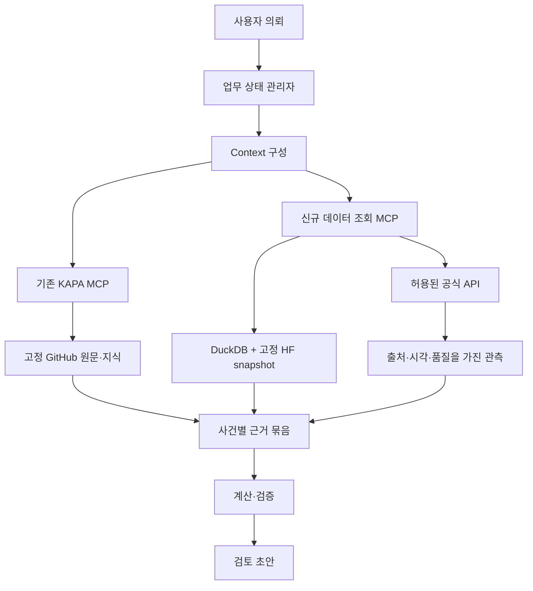

<!-- SPDX-License-Identifier: GPL-3.0-only -->
# 01. 시스템 아키텍처

## 목표와 경계

공식 자료와 판본을 확인하면서 거래사례 조사, 공부 확인, 규제 검토, 계산, 검토 초안 작성을 지원한다. 검색 적중·해시 일치·평가 점수만으로 법적 적용이나 평가액의 적정성을 보증하지 않는다. 최초 범위는 단일 사용자 로컬 실행이다.

## 책임 배치

| 계층 | 기준 위치 | 책임 |
|---|---|---|
| 시험 원본 | kapa_edu_1/2 | 기출·정답 출처·시험 시점 보존 |
| 규범·절차 | kapa_skills | 법령·실무기준 원문, 작업 Skills |
| 법률 지식 | kapa_knowledge | 판례·해석·쟁점·관계·검토, 향후 Claim |
| 기존 도구 | kapa_mcp | 기존 읽기·evidence·render 계약 |
| 신규 실행 | kapa_runtime (제안) | API 어댑터, 수집·정규화·HF 릴리스, 신규 MCP |
| 데이터 배포 | HF Private Datasets | 커밋으로 고정한 Parquet·검색 파생물·평가셋 |
| 분석 | 로컬 DuckDB | 금액·면적·기간·지역 필터, 집계·조인 |
| 업무 상태 | 로컬 SQLite | 사건 상태·실행·승인·checkpoint·재시도 |
| 사건 산출물 | _kapa_data/matters | 고객별 근거 묶음·계산·검토 기록, HF 기본 제외 |

HF는 운영 트랜잭션 DB의 역할을 맡지 않는다. 생성된 검색 인덱스와 그래프는 GitHub의 고정된 원문·관계에서 재생성 가능해야 한다. 법령 본문이나 검토 상태를 HF에서 독립 편집하지 않는다.

## 제안 로컬 배치

```text
KAPA_edu/
  design/                        이번 설계안
  kapa_edu_1/                    기존
  kapa_edu_2/                    기존
  kapa_skills/                   기존
  kapa_knowledge/                기존
  kapa_mcp/                      기존, 외부 키를 추가하지 않음
  kapa_runtime/                  향후 신규 private 코드 레포
    src/kapa_runtime/
      credentials/ adapters/ normalization/ releases/
      query/ workflows/ mcp/ validation/
    schemas/ tests/ docs/ .github/workflows/
  _kapa_data/                    향후 로컬, 코드 레포 외부
    staging/ snapshots/ cache/ state/ matters/ manifests/
  data_gov_key.txt               기존 로컬 키, 내용 복사 금지
  hf_token.txt                   기존 로컬 토큰, 내용 복사 금지
```

기존 `_kapa_jobs`는 기존 조판 규칙을 따른다. 신규 데이터를 기존 jobs registry에 임의 편입하지 않는다. `_kapa_data`에는 접근 제어·백업·보존 정책을 별도 적용한다.

## 조회 흐름



캐시 조회와 실시간 API 조회는 응답에 명시한다. API 조회가 외부 서비스에는 읽기여도 로컬 관측·캐시를 쓰면 도구 전체를 순수 읽기로 표시하지 않는다. 사용자 요청만으로 HF 데이터셋 전체를 매번 내려받지 않고 manifest와 해당 파티션만 고정해 캐시한다.

## HF 데이터셋 후보

HF namespace는 아직 미정이다. 다음 이름은 후보이며 실제 리소스가 아니다.

| 후보 이름 | 내용 | 기본 배포 조건 |
|---|---|---|
| kapa-market-data | 정규화 거래·임대차, 버전 관측 | private, 서비스별 저장·재배포 조건 확인 |
| kapa-property-data | 공부·토지·규제 snapshot | private, 허용된 필드·보존 범위만 |
| kapa-knowledge-index | 문서 조각·관계·선택적 임베딩 | 원본 커밋·chunker·모델 버전 기록 |
| kapa-evals | 합성·검토 평가셋 | 원자료 이용 범위, 정답 접근 분리 |

고객 사건 자료·키·미검토 수집 로그는 공통 HF 데이터셋 업로드 대상에서 제외한다. private라는 사실만으로 타 기관 자료의 재배포 권한을 추정하지 않는다.

## 성장 경로

1. 로컬: HF + DuckDB + SQLite, 단일 writer와 업무별 고정 snapshot.
2. 상시 서버: 실행 계정의 비밀 저장소, 인증된 private 접근, 모니터링.
3. 다중 사용자: PostgreSQL로 상태·권한·동시 쓰기를 이전하고 필요하면 PostGIS 사용.
4. 관계 탐색/의미 검색이 평가상 병목일 때 그래프 DB·벡터 인덱스 도입. 도입 전 키워드·정형 검색 대비 품질을 비교한다.

Spaces는 선택적 검토 UI 후보다. 현재 설계의 필수 서버가 아니며 기본 임시 디스크에 업무 DB를 두지 않는다. 원격 MCP를 도입하려면 기존 loopback 계약과 별개로 인증·인가·네트워크 경계를 설계해야 한다.
